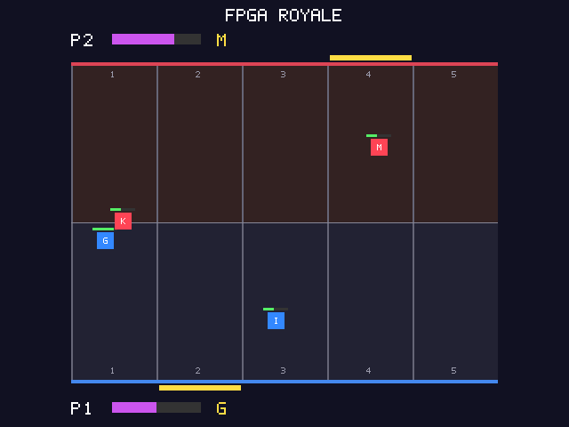

# ModelSim verification checkpoint

## November 18, 2026 revalidation

Reviewed partner commit `02b08d7` (V1), with local timing fixes. All RTL and testbenches compile as Verilog-2001 with ModelSim SE-64 10.6e (`-vlog01compat`).

| Testbench | Result |
| --- | --- |
| `game_core_tb` | 51 checks passed |
| `input_tb` | 11 checks passed |
| `video_tb` | 22 checks passed, plus 307,200 defined rendered pixels |
| `display_io_tb` | 1,155 checks passed |

The display I/O test elaborates the complete board top level. It verifies pixel-enable capture/hold behavior for renderer snapshots and RGB/sync, raster stability between pixel enables, reset behavior, and both players' multiplexed decimal displays for every elixir value from 0 through 10.

A separate comparison against the V1 renderer checked 1,536,000 identical pixels across gameplay, title, P1 win, P2 win, and draw screens after reducing glyph/text arithmetic widths. The reference is the `rtl/vga_bitchange.v` implementation in commit `02b08d7`.

After caching lane contact between game ticks, a separate ModelSim comparison against `02b08d7:rtl/game_core.v` passed 20,000 comparisons of all public outputs, movement/attack cooldowns, and match/elixir counters: 10,000 randomized valid pre-tick fixtures and 10,000 sequential game ticks. Sequential ticks used the minimum supported spacing of one idle system-clock edge; the actual board has 1,680,000 clocks per frame. The cached contact flags must settle during that idle edge before the following tick.

Current logs and the sample frame are under `build/questasim/`. The one-time equivalence logs are under `build/renderer_equivalence/` and `build/core_equivalence/`. FPGA implementation results are recorded separately after the Vivado build completes.

## Original November 12 checkpoint

Verified November 12, 2026 using ModelSim SE-64 10.6e.

All RTL and testbenches compiled with `vlog -vlog01compat`, zero compilation errors and warnings. No SystemVerilog mode was enabled.

| Testbench | Result | Coverage |
| --- | --- | --- |
| `game_core_tb` | 50 checks passed | Deployment, elixir, occupied/invalid lanes, simultaneous combat, Giant passing, lane isolation, scoring, draws, timeout, reset |
| `input_tb` | 10 checks passed | Both toggle edges, input filtering, independent requests, selection snapshots, tick-edge requests |
| `video_tb` | 8 checks passed | Full 800x525 raster, 640x480 active area, horizontal/vertical sync, frame tick, blanking, title/draw output |

The video test additionally checked all 307,200 pixels in the sample frame for unknown values. The attached image is a test fixture rendered by the hardware renderer; it is not a physical-board photograph or a recorded play session.

This checkpoint predates the EE354 skeleton renames (`display_controller.v`, `vga_bitchange.v`, `royale_params.vh`). Reproduce from the repository root with `./scripts/simulate_questasim.ps1` (override `-QuestaBin` if needed; requires a license) or `bash scripts/simulate_icarus.sh`. Logs and the PPM image go into `build/questasim/` or `build/icarus/`.

Synthesis, implementation timing, bitstream generation, and physical-board behavior are not covered by these simulation results.
