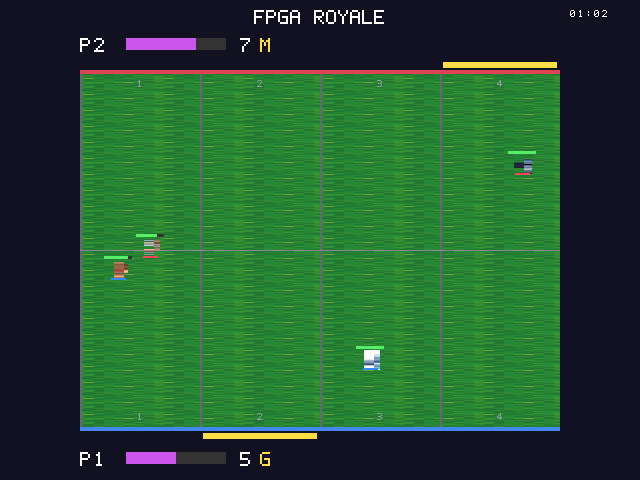

# Simulation verification checkpoint

## November 18, 2026 revalidation

Andy's timing commit `4c6a51d` passed the following ModelSim checks before the
four-lane/multi-troop feature merge:

| Testbench | Result |
| --- | --- |
| `game_core_tb` | 51 checks passed |
| `input_tb` | 11 checks passed |
| `video_tb` | 22 checks passed, plus 307,200 defined rendered pixels |
| `display_io_tb` | 1,155 checks passed |

The display I/O test elaborates the complete board top level. It verifies pixel-enable capture/hold behavior for renderer snapshots and RGB/sync, raster stability between pixel enables, reset behavior, and both players' multiplexed decimal displays for every elixir value from 0 through 10.

A separate comparison against the V1 renderer checked 1,536,000 identical pixels across gameplay, title, P1 win, P2 win, and draw screens after reducing glyph/text arithmetic widths. The reference is the `rtl/vga_bitchange.v` implementation in commit `02b08d7`.

After caching lane contact between game ticks, a separate ModelSim comparison against `02b08d7:rtl/game_core.v` passed 20,000 comparisons of all public outputs, movement/attack cooldowns, and match/elixir counters: 10,000 randomized valid pre-tick fixtures and 10,000 sequential game ticks. Sequential ticks used the minimum supported spacing of one idle system-clock edge; the actual board has 1,680,000 clocks per frame. The cached contact flags must settle during that idle edge before the following tick.

Current logs and the sample frame are under `build/questasim/`. The one-time equivalence logs are under `build/renderer_equivalence/` and `build/core_equivalence/`. FPGA implementation results are recorded separately after the Vivado build completes.

## Merged feature verification

The merged four-lane implementation was verified using Icarus Verilog in
Verilog-2001 mode:

| Testbench | Result | Coverage |
| --- | --- | --- |
| `game_core_tb` | 70 checks passed | Per-card elixir rejection, multiple card types per lane, duplicate prevention, combat, slower movement, scoring, restart |
| `input_tb` | 11 checks passed | Button edges, input filtering, independent requests, selection snapshots, tick-edge requests |
| `video_tb` | 26 checks passed | Full raster/sync timing, sprite/grass ROM output, numeric elixir, normalized health, timer, overlays |

The video test additionally checked all 307,200 pixels in the sample frame for unknown values. The attached image is a test fixture rendered by the hardware renderer; it is not a physical-board photograph or a recorded play session.

Reproduce from the repository root with `bash scripts/simulate_icarus.sh`, or use
`./scripts/simulate_questasim.ps1` when QuestaSim is available. Logs and the PPM image
go into `build/icarus/` or `build/questasim/`.

The merged feature build has not yet been rerun through Vivado implementation.
